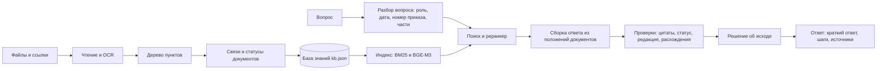

# Навигатор по регламентам МФТИ

Кейс 4 хакатона «ИИ в системе управления МФТИ»: «Навигатор сотрудника по внутренним регламентам». Команда lowkey skill issue.

Сотрудник задаёт вопрос своими словами. Система находит нужный регламент или приказ, даёт краткий ответ и порядок действий,
к каждому шагу приводит название документа и пункт, а если в базе ответа нет, прямо говорит об этом.
Ответ собирается только из дословных положений документов: домыслов нет по построению.

Запись демонстрации: `demo/navigator_demo.mp4` (версия до 3 минут: `submission/navigator_demo_3min.mp4`). Презентация: `submission/navigator_presentation.pdf`. Примеры ответов: `examples/README.md`. Сценарий показа: `docs/DEMO.md`. Архитектура: `docs/ARCHITECTURE.md`.

## Соответствие критериям оценки

| Критерий | Где это в проекте |
|---|---|
| 1. Обработка и индексирование документов (16) | `navigator/ingest/`: PDF, DOCX, DOC, RTF, ODT, XLSX, HTML, TXT, сканы через OCR; дерево «раздел, пункт, подпункт, абзац» (`structure.py`), заголовки без номера распознаются по оформлению; новые документы добавляются без кода (страница «Администратору», `make rebuild-org`); сканы, повреждённые и неподдерживаемые файлы попадают в паспорт базы, пересборка не обнуляет базу при ошибке; тесты `tests/test_ingest.py`, `tests/test_audit_fixes.py`, `tests/test_robustness.py` |
| 2. Поиск документа и фрагмента (20) | `navigator/index/`, `navigator/qa/retrieve.py`: BM25, плотный поиск BGE-M3, слияние RRF, реранкер; статусы и редакции в `navigator/ingest/graph.py`; вопрос «по состоянию на дату» ищет по документам, действовавшим на эту дату (`navigator/qa/timeline.py`); глоссарий бытовых формулировок `data/glossary.yaml`; составные вопросы разбираются по частям |
| 3. Ответ и порядок действий (20) | `navigator/qa/generate.py`: краткий ответ из ключевых положений, порядок действий из раздела документа с процедурой в порядке документа; `navigator/qa/verify.py`: каждая цитата сверяется с текстом пункта |
| 4. Цитирование и неопределённость (16) | У каждого шага название документа, пункт и страница; исходы «частичный ответ», «в документах нет ответа», «нужно уточнение», «документ отменён» (`navigator/qa/policy.py`); расхождение между документами показывается с обоими пунктами (`navigator/ingest/contradictions.py`, `navigator/qa/engine.py`) |
| 5. Пользовательский сценарий и надёжность (8) | Интерфейс `navigator/ui/app.py`; некорректные запросы и технические ошибки не роняют интерфейс и API (`navigator/qa/engine.py`, `navigator/api/app.py`); 54 теста |
| 6. Развёртываемость (20) | `Dockerfile`, `docker-compose.yml`, `scripts/docker_entrypoint.sh`, `.env.example`; сборка образа и ответ сервиса проверяются в CI (`.github/workflows/docker.yml`); этот файл, `docs/ARCHITECTURE.md`, 12 сценариев в `examples/` |

## Быстрый старт в Docker

Требования: Docker 24+ с Compose v2, 8 ГБ памяти для Docker (от 10 ГБ для полного режима поиска), 12 ГБ диска, интернет на время сборки.

```bash
docker compose up -d --build
```

Интерфейс: http://localhost:8501. Сборка занимает 8–15 минут: ставятся зависимости и в образ скачиваются модели поиска (около 4,6 ГБ).
После сборки интернет не нужен: база организаторов, документы и распознанный текст сканов лежат в репозитории.
Журнал запуска и выбранный режим поиска: `docker compose logs -f`.

API (необязательный сервис, отдельный процесс со своими копиями моделей), документация http://localhost:8000/docs:

```bash
docker compose --profile api up -d --build
```

Остановка:

```bash
docker compose --profile api down
```

Облегчённый режим без моделей и без скачиваний (только BM25), для слабой машины или закрытой сети:

```bash
make up-light
```

Режим поиска контейнер выбирает по памяти Docker: от 9,5 ГБ полный (BM25, BGE-M3, реранкер), от 4,5 ГБ BM25 и реранкер
(на тест-наборах исходы те же), меньше 4,5 ГБ BM25 без моделей. Если Hugging Face недоступен, сборка не падает, сервис работает
в режиме BM25; зеркало задаётся переменной `HF_ENDPOINT`. В контейнере модели работают на CPU, поэтому реранкер переходит
в экономный режим (меньше кандидатов, короче тексты); времена в таблице качества сняты на Apple Silicon.

Сборка образа локально не запускалась (на машине разработки нет Docker): её проверяет CI, задача `smoke` в `.github/workflows/docker.yml`
собирает образ, поднимает сервисы и проверяет ответ API и интерфейса.

## Запуск без Docker

Требования: Python 3.11+, для сканов tesseract с русским языком (на macOS используется встроенное распознавание Vision).

```bash
make venv
```

```bash
make ui-org
```

Интерфейс откроется на http://localhost:8501 по готовой базе `data/kb/org`. Первый запуск скачивает модели поиска. Остановка: Ctrl+C.

Остальные команды:

| Команда | Что делает |
|---|---|
| `make api` | API на http://localhost:8000/docs |
| `make rebuild-org` | пересобрать базу из `data/raw/org`: разбор, индекс, поиск расхождений |
| `make crawl URL=https://...` | скачать документы со страницы сайта в `data/raw/org_web` |
| `make test`, `make lint` | 54 теста и проверка стиля |
| `make examples` | заново сформировать примеры в `examples/` |
| `.venv/bin/python scripts/ask.py "Как оформить служебную командировку?"` | вопрос из терминала |
| `.venv/bin/python scripts/run_eval.py --kb data/kb/org --testset data/eval/testset_org.yaml --label run` | прогон тест-набора |

## Зависимости

Python 3.11+ (образ на 3.13). Библиотеки перечислены в `requirements.txt`, для образа версии зафиксированы в `requirements-lock.txt`.
Основные: pymupdf, python-docx, rank-bm25, snowballstemmer, rapidfuzz, pydantic, streamlit 1.67+, fastapi, uvicorn;
torch и sentence-transformers для плотного поиска и реранкера. Системные: tesseract-ocr с русским языком, antiword и catdoc для файлов .doc
(в образе установлены).

## Переменные окружения

Файл `.env` необязателен: без него всё работает со значениями по умолчанию. Образец: `.env.example`, полный список: `navigator/config.py`.

| Переменная | По умолчанию | Назначение |
|---|---|---|
| `NAVIGATOR_KB` | `data/kb/org` | каталог базы знаний |
| `NAVIGATOR_RAW` | `data/raw/org` | папка документов для пересборки в контейнере |
| `NAVIGATOR_USE_DENSE` | `auto` | плотный поиск: auto, on, off, hash |
| `NAVIGATOR_USE_RERANKER` | `auto` | реранкер: auto, on, off |
| `NAVIGATOR_TOP_K_CANDIDATES`, `NAVIGATOR_TOP_K_FINAL` | 40, 8 | число кандидатов для реранкера и пунктов в ответе |
| `NAVIGATOR_GATE_MIN_RERANK` | 0.2 | порог отказа по оценке реранкера |
| `NAVIGATOR_RERANK_BUDGET` | `auto` | бюджет реранкера: full, lite (экономный для CPU), auto по устройству |
| `NAVIGATOR_DEVICE` | `auto` | устройство для моделей: cpu, mps, cuda |
| `NAVIGATOR_OCR` | `auto` | распознавание сканов: auto, tesseract, ocrmac, easyocr, off |
| `NAVIGATOR_LLM` | `auto` | модель ответа: anthropic, openai_compat, mock; по умолчанию без модели |
| `ANTHROPIC_API_KEY`, `NAVIGATOR_MODEL_GENERATOR`, `NAVIGATOR_MODEL_EXTRACTOR`, `NAVIGATOR_MODEL_JUDGE` | нет | внешняя модель, только для открытых баз |
| `NAVIGATOR_OPENAI_BASE_URL`, `NAVIGATOR_OPENAI_MODEL`, `NAVIGATOR_OPENAI_API_KEY` | нет | локальная модель через OpenAI-совместимый адрес; из контейнера сервер на хосте виден как `http://host.docker.internal:<порт>/v1` |
| `NAVIGATOR_LLM_CACHE` | 1 | кэш ответов модели |
| `NAVIGATOR_ALLOW_EXTERNAL_LLM` | нет | разрешить внешнюю модель для базы, помеченной закрытой |
| `NAVIGATOR_TODAY` | нет | дата «сегодня» для воспроизводимых прогонов |
| `PRELOAD_MODELS` | 1 | только Docker: скачать модели в образ при сборке |
| `HF_ENDPOINT` | нет | зеркало Hugging Face |
| `NAVIGATOR_UI_PORT`, `NAVIGATOR_API_PORT`, `NAVIGATOR_BIND` | 8501, 8000, 0.0.0.0 | порты и адрес на хосте |
| `NAVIGATOR_MEM_FULL_MB`, `NAVIGATOR_MEM_RERANK_MB`, `NAVIGATOR_MODEL_TIMEOUT` | 9500, 4500, 2400 | пороги памяти для выбора режима и предел ожидания загрузки модели |

## Внешние сервисы и закрытые данные

По условию кейса через внешние API можно передавать только открытые данные. Поэтому по умолчанию ответ формируется без языковой модели,
поиск и проверки работают локально. База организаторов помечена закрытой (`data/kb/org/policy.json`): внешняя модель для неё отключается автоматически.
Сеть нужна только при сборке: Hugging Face Hub (модели BGE-M3 и bge-reranker-v2-m3), PyPI, download.pytorch.org, Debian, Docker Hub.

Путь с языковой моделью (Anthropic API для открытых баз, локальная модель через OpenAI-совместимый адрес) реализован в `navigator/llm/`,
но вживую не запускался: ключа нет, а закрытые документы передавать внешнему сервису нельзя.

## Как это работает



Подробности и причины решений: `docs/ARCHITECTURE.md`.

## Что умеет ответ

| Ситуация | Что получает пользователь |
|---|---|
| Вопрос «как сделать» | краткий ответ и порядок действий: пункты раздела документа, который описывает процедуру, в порядке документа; короткий раздел показывается целиком |
| Вопрос о факте («сколько», «какой срок») | краткий ответ и основание: дословные пункты; элемент перечня показывается с вводной фразой |
| Составной вопрос | у каждой части свой пункт; непокрытая часть перечисляется в блоке «Не найдено в документах базы», исход «частичный ответ» |
| Несколько документов | объединённый ответ с названием каждого документа; расхождение между документами показывается с обоими пунктами дословно |
| Слишком общий вопрос | уточнение со списком подходящих документов; выбор документа сужает поиск |
| Ответа в базе нет | отказ со списком проверенных документов |
| Отменённый или заменённый приказ | уведомление с основанием отмены, даже если текста приказа в базе нет |
| Вопрос «по состоянию на 2019 год» | ответ по редакции, действовавшей на эту дату; у документа показан статус на дату и сегодняшний |
| Вопрос о содержании приказа | пункты приказа по порядку |
| Некорректный запрос, техническая ошибка | понятное сообщение без падения |

У каждого ответа есть строка «Проверки»: цитаты найдены и совпадают с текстом, документы действуют на дату запроса, редакция актуальна,
качество распознавания, уверенность поиска, расхождения с другими документами.

## Интерфейс

Пять страниц в верхней навигации, боковой панели нет.

- «Спросить»: примеры вопросов, поле ввода внизу, роль и дата в одном меню; под каждым шагом строка источника, которая раскрывается в текст пункта и страницу оригинала с подсветкой.
- «Мой навигатор»: документы, применимые к роли, изменения за период, отметки об ознакомлении.
- «Документы»: вся база со статусами, темами и структурой пунктов.
- «Администратору»: источники (загрузка файлов, ссылки, обход сайта, переиндексация), паспорт базы, расхождения, влияние нового приказа, проверенные ответы.
- «Качество»: метрики прогонов.

## Форматы и ограничения

Читаются: PDF (включая сканы через OCR), DOCX, DOC (antiword или catdoc, на macOS textutil), RTF, ODT, XLSX, HTML, TXT и MD
в распространённых кодировках (UTF-8, UTF-16, windows-1251, KOI8-R), сканы-изображения JPG, PNG, TIFF, BMP при доступном OCR.
Не читаются XLS, PPT, PPTX, DJVU и архивы: такие файлы перечисляются в паспорте базы с подсказкой.
Пересборка не изменяет базу, если источник недоступен или в нём нет читаемых документов: команда завершается с ошибкой и кодом 2.

Ограничения:

- без языковой модели шаги приводятся дословно, как в документе, без пересказа;
- связи между документами извлекаются правилами; ссылки нестандартного вида могут не распознаться и тогда видны в паспорте базы;
- расхождения между документами ищутся как кандидаты (близкий смысл, разные числа) и требуют проверки человеком;
- в режиме BM25 без моделей качество ниже, чем в полном (см. таблицу);
- в контейнере на CPU ответ с реранкером занимает заметно больше времени, чем на Apple Silicon.

## Качество

База организаторов: 20 файлов, 28 документов, 1068 пунктов в индексе. Тест-наборы: `data/eval/`, результаты: `data/eval/results/`, метрики и запуск: `navigator/eval/run.py`.

| Набор и режим | Вопросов | Нужный документ первым | В первых трёх | Верный исход | Ложные ответы | Переотказы |
|---|---|---|---|---|---|---|
| Организаторы, полный режим | 42 | 1,000 | 1,000 | 42 из 42 | 0 | 0 |
| Организаторы, отложенный набор | 14 | 1,000 | 1,000 | 13 из 14 | 0 | нет таких вопросов |
| Организаторы, BM25 и реранкер без плотного поиска | 42 | 1,000 | 1,000 | исходы те же, что в полном режиме | 0 | 0 |
| Организаторы, только BM25 | 42 | 0,969 | 0,969 | 0,738 | 0,25 | 0,14 |
| Публичные документы mipt.ru, полный режим (прогон до последних правок разбора) | 42 | 0,806 | 0,935 | 0,881 | 0,10 | 0,05 |
| Публичные документы mipt.ru, только BM25 (прогон до последних правок разбора) | 42 | 0,903 | 0,968 | 0,690 | 0,30 | 0,30 |

«Ложные ответы»: доля вопросов без ответа в базе, на которые система всё же ответила. «Переотказы»: доля прямых вопросов, на которые система отказала.
Плотный поиск на этих наборах исходы не меняет; он оставлен по умолчанию ради перефразированных вопросов и роста базы до сотен документов.
Единственный промах отложенного набора: вопрос о приказе, которого нет в базе и который известен только по ссылке.

## Структура репозитория

| Путь | Содержимое |
|---|---|
| `navigator/ingest/` | чтение файлов, OCR, структура пунктов, связи и статусы, поправки, расхождения, обход сайта, анализ влияния приказа |
| `navigator/index/` | BM25, плотные векторы, реранкер |
| `navigator/qa/` | разбор вопроса, поиск, сборка ответа, проверки, решение об исходе, сроки, проверенные ответы, статусы на дату |
| `navigator/llm/` | подключение моделей и защита закрытых данных |
| `navigator/ui/`, `navigator/api/` | интерфейс Streamlit и API FastAPI |
| `navigator/eval/`, `data/eval/` | метрики, тест-наборы, результаты |
| `data/raw/org`, `data/kb/org` | документы организаторов и готовая база |
| `scripts/` | пересборка, вопрос из терминала, прогон оценки, примеры, запись видео |
| `tests/` | 54 теста |
| `docs/`, `examples/`, `demo/` | документация, примеры ответов, видео |
