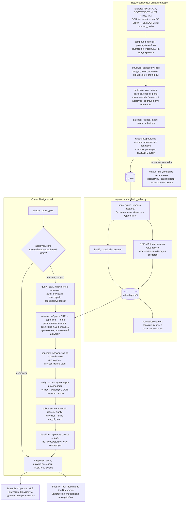

# Архитектура

## Поток данных

## Компоненты

| Модуль | Что делает | Почему так |
|---|---|---|
| `navigator/ingest/loaders.py` | Текст по страницам из PDF, DOCX, DOC/RTF/ODT (через textutil на macOS), XLSX, HTML, TXT. OCR страниц без текстового слоя с кэшем по хешу файла | Организаторы выдают файлы в форматах, которыми пользуются внутри вуза; сканы в реальных базах обычны |
| `navigator/ingest/compound.py` | Делит файл «приказ плюс утверждённое положение» на два логических документа | Иначе положение получает тип «приказ» и заголовок приказа, а статусы считаются неверно |
| `navigator/ingest/structure.py` | Дерево пунктов с номерами, приложениями и страницами; запасной режим абзацных чанков, если нумерации нет | Единица цитаты должна быть пунктом, иначе ответ нельзя проверить по документу |
| `navigator/ingest/metadata.py` | Тип, номер, дата, заголовок, даты действия, роли; связи между документами из формул «признать утратившим силу», «внести изменения», «утвердить», «утверждено приказом» | Связи нужны для статусов и редакций; регулярные выражения дешёвые и объяснимые |
| `navigator/ingest/patches.py` | Поправки четырёх типов и их применение к пунктам с сохранением исходного текста и provenance | Ответ должен опираться на действующую редакцию пункта, а не на текст до поправки |
| `navigator/ingest/graph.py` | Разрешение ссылок (номер и дата, утверждающий приказ, заголовок с защитой), статусы active / cancelled / superseded / expired, редакции по заголовку, заглушки для отсутствующих документов, аудит | Отмены и редакции считаются один раз для всей базы, а не на каждом вопросе |
| `navigator/ingest/impact.py` | Копия базы плюс новый приказ: изменения статусов и пунктов, затронутые роли, вопросы с другим ответом | Администратору важно видеть последствия до загрузки в базу |
| `navigator/ingest/contradictions.py` | Пары действующих пунктов разных документов с похожими эмбеддингами и разными числами | Находит конфликтующие сроки и суммы в самой базе; выдаётся как список на проверку |
| `navigator/ingest/extract_llm.py` | При `--llm`: уточнение метаданных, процедуры, обязанности, связи; расшифровка сканов моделью | Дорогой проход выполняется один раз при индексации |
| `navigator/index/` | BM25 со стеммингом, BGE-M3 (или хеш-эмбеддинг), слияние RRF, реранкер bge-reranker-v2-m3, кэш эмбеддингов по хешу текста, индекс в отдельном каталоге для каждого эмбеддера | Лексика ловит номера и термины, вектор ловит перефразировки, реранкер даёт калибруемый порог отказа |
| `navigator/qa/query.py` | Роль из вопроса, упомянутые номера документов, даты ситуации, «по состоянию на», глоссарий бытовой лексики, переформулировки (с моделью: разбор вопроса структурно) | Закрывает разрыв между «как уйти в академ» и «порядок предоставления академического отпуска» |
| `navigator/qa/retrieve.py` | Гибридный поиск, мягкий буст по роли и упомянутому документу, реранжирование, расширение контекста по структуре | Процедура обычно разложена по соседним пунктам одного раздела и по ссылкам «в соответствии с п. X» |
| `navigator/qa/generate.py` | Генерация AnswerDraft по строгой схеме; без модели экстрактивный режим: лучшие предложения пунктов | Схема делает ответ проверяемым и одинаково рендерится в UI и API |
| `navigator/qa/verify.py` | Детерминированные проверки цитат и статусов, судья по шагам (с моделью) или эвристика покрытия (без модели), проверки ответа | Генератор оптимизирует полезность, верификатор строгость |
| `navigator/qa/policy.py` | Исход по правилам ниже | Отказ и уточнение должны быть предсказуемы и объяснимы |
| `navigator/qa/deadlines.py` | Правила сроков из текста («не позднее чем за N дней до», «в течение N дней со дня», фиксированные даты) и расчёт дат по производственному календарю | Пользователю нужна дата, а не формула; считает код |
| `navigator/qa/approved.py` | Подтверждённые ответы с эмбеддингом вопроса, хешами процитированных пунктов и статусами документов; устаревание при любом изменении | Переводит ответ из «модель сказала» в «подразделение подтвердило» |
| `navigator/qa/mynav.py` | Применимые документы по роли, изменения за период, требования и сроки, отметки «прочитано» | Экран «Мой навигатор» |
| `navigator/llm/` | Единый интерфейс `structured(system, user, schema, model, effort)`: Anthropic (messages.parse, PDF на вход, серверные fallbacks), OpenAI-совместимые (vLLM, прокси), mock; кэш ответов в sqlite | Провайдер меняется переменной окружения; данные могут не покидать контур |
| `navigator/eval/` | Тест-набор YAML, метрики, отчёт markdown и JSON | Качество доказывается прогоном, а не словами |
| `navigator/api/app.py`, `navigator/ui/app.py` | FastAPI и Streamlit поверх одного `Navigator` | Один движок, два интерфейса |

## Схемы данных (navigator/schemas.py)

| Схема | Ключевые поля |
|---|---|
| `Document` | `id`, `source_path`, `source_url`, `title`, `doc_type`, `number`, `date`, `effective_from`, `effective_to`, `roles`, `status` (active, cancelled, superseded, expired, unknown), `status_reason`, `edition_group`, `superseded_by`, `cancelled_by`, `amended_by`, `approved_by`, `pages`, `ocr_quality`, `needs_ocr`, `clauses`, `relations`, `patches`, `unapplied_patches`, `procedures`, `obligations`, `responsible_units`, `summary`, `warnings` |
| `Clause` | `id` («2.4», «Прил.1:3», «p12»), `number`, `level`, `kind` (heading, clause, item, order_item, paragraph, preamble, table), `text`, `parent_id`, `children`, `path`, `page_start`, `page_end`, `attachment`, `deleted`, `provenance` (приказы-поправки), `original_text` |
| `Relation` | `type` (cancels, amends, approves, approved_by, replaces, references), `source_doc_id`, `target_doc_id`, `target_ref`, `target_kind`, `target_number`, `target_date`, `target_title`, `clause_id`, `confidence`, `method` (regex, llm, manual), `external`, `approving_number`, `approving_date` |
| `Patch` | `op` (replace, insert, delete, substitute), `source_doc_id`, `source_clause_id`, `target_doc_id`, `clause_number`, `new_text`, `old_fragment`, `new_fragment`, `applied`, `note` |
| `AnswerDraft` | `answerable` (yes, partial, no), `summary`, `applicable_documents`, `steps[]` с `citations[] = {doc_id, clause_id, quote}`, `conditions`, `not_covered`, `role_branches`, `clarifying_question`, `clarifying_options`, `responsible`, `forms`, `deadlines` |
| `Response` | `outcome` (answer, partial, refuse, clarify, cancelled_notice, out_of_scope), `question`, `role`, `as_of`, `summary`, `steps` (с `verdict` supported / partial / unsupported), `conditions`, `not_covered`, `documents`, `checked_documents`, `clarifying_question`, `clarifying_options`, `responsible`, `forms`, `deadlines`, `trust`, `trace`, `timings_ms` |
| `TrustCard` | `checks[] = {name, passed, detail}`, `supported_steps`, `total_steps`, `dropped_steps`, `warnings`, `verified_by_human` |
| `KnowledgeBase` | `documents`, `built_at`, `audit` (`findings`, `counts`), `stubs` (документы, на которые ссылаются, но которых нет) |

Проверки ответа (строка «Проверки» в интерфейсе): «Цитаты указывают на переданные пункты», «Текст цитат совпадает с документом», «Документы действуют на дату запроса», «Редакция пунктов актуальна», «Качество распознавания текста», «Шаги подтверждены документами», «Уверенность поиска», «Противоречий с другими действующими пунктами не найдено», при подтверждении сотрудником «Подтверждено сотрудником».

## Политика исхода (navigator/qa/policy.py)

Порядок проверки правил:

1. Вопрос вне области (`out_of_scope`) → `out_of_scope`.
2. Упомянутый номер документа не найден в базе → `refuse` с фразой «Документ № … в базе отсутствует».
3. Упомянутый документ отменён, заменён или истёк → `cancelled_notice` с указанием отменяющего документа.
4. Генератор задал уточняющий вопрос, роль не указана, нормы расходятся по ролям → `clarify`.
5. Поиск уверен, роль не указана, верхние документы адресованы разным сторонам (обучающиеся и работники) → `clarify`.
6. Генератор ответил «нет» или ни один шаг не подтверждён → `refuse` с перечнем проверенных документов.
7. Поиск не уверен (порог не пройден) → `partial`.
8. Часть шагов отброшена, ответ частичный или есть `not_covered` → `partial`.
9. Иначе → `answer`.

Пороги из `navigator/config.py`, все переопределяются переменными окружения:

| Параметр | Значение по умолчанию | Смысл |
|---|---|---|
| `GATE_MIN_RERANK` | 0.2 | минимальный скор реранкера лучшего пункта (после сигмоиды) |
| `GATE_MIN_DENSE` | 0.45 | косинус BGE-M3, если реранкер выключен |
| `GATE_MIN_HASH` | 0.18 | косинус хеш-эмбеддинга в режиме без моделей |
| `QUOTE_MATCH_THRESHOLD` | 88 | нечёткое совпадение цитаты с текстом пункта (rapidfuzz partial_ratio) |
| `CLARIFY_SCORE_GAP` | 0.08 | насколько близкими должны быть верхние документы разных ролей для уточнения |
| `TOP_K_CANDIDATES`, `TOP_K_FINAL` | 40, 8 | кандидаты до реранжирования и пункты в контексте |
| `MAX_CONTEXT_CHARS` | 24000 | бюджет контекста генератора |

Проверенные ответы: порог сходства вопросов 0.90 (`SIM_THRESHOLD` в `navigator/qa/approved.py`). Противоречия: порог сходства пунктов 0.80 (`scripts/find_contradictions.py --threshold`).

## Точки замены модели

| Переменная | Значения | Поведение |
|---|---|---|
| `NAVIGATOR_LLM` | `auto`, `anthropic`, `openai_compat`, `mock` | `auto`: Anthropic при наличии `ANTHROPIC_API_KEY`, иначе режим без модели |
| `NAVIGATOR_MODEL_GENERATOR`, `NAVIGATOR_MODEL_EXTRACTOR`, `NAVIGATOR_MODEL_JUDGE` | идентификаторы моделей | по умолчанию `claude-opus-5-5`, `claude-opus-5-5`, `claude-haiku-5-5` |
| `NAVIGATOR_EFFORT_*` | `low` … `max` | усилие модели для генератора, экстрактора, судьи |
| `NAVIGATOR_OPENAI_BASE_URL`, `NAVIGATOR_OPENAI_MODEL`, `NAVIGATOR_OPENAI_API_KEY` | адрес vLLM или прокси | локальные и российские модели через OpenAI-совместимый интерфейс |
| `NAVIGATOR_LLM_CACHE` | `1` / `0` | кэш структурных ответов модели в `data/llm_cache.sqlite` |
| `NAVIGATOR_USE_DENSE`, `NAVIGATOR_USE_RERANKER` | `auto`, `on`, `off`, `hash` | состав поиска |
| `NAVIGATOR_OCR` | `auto`, `tesseract`, `ocrmac`, `easyocr`, `off` | движок распознавания сканов |

В режиме без модели работают поиск, расширение по структуре, проверка цитат и статусов, политика исхода, сроки, проверенные ответы и анализ влияния. Не работают: пошаговая инструкция своими словами (шаги выдаются выдержками пунктов), уточняющие вопросы по смыслу, частичные ответы с перечнем непокрытого, LLM-экстракция документов.

## Известные ограничения

- Модельный путь написан по документации SDK и не исполнялся вживую: нужен прогон тест-набора с ключом и калибровка порогов на отложенной части.
- Поправки «изложить в редакции согласно приложению» без текста в самом приказе не применяются автоматически и попадают в список администратора.
- Роли документов извлекаются эвристиками по заголовку, предложению «распространяется на» и частотам слов.
- Разрешение ссылок по названию защищено порогом и правилами (не отменять то, что сам утверждает, не отменять более поздние документы), но на базах с одинаковыми названиями разных актов возможны ошибки, которые видны в паспорте базы.
- Производственный календарь заложен на 2026 и 2027 годы; для других лет учитываются фиксированные праздники.
- Превью страницы с подсветкой работает для PDF с текстовым слоем; для сканов показывается страница без подсветки.
- Статусы документов рассчитываются на текущую дату; при вопросе «на другую дату» система предупреждает, а не пересчитывает граф.

## Изменения после получения документов организаторов (14 ноября)

Реальные документы показали шаблоны, которых не было в публичной базе, и под них доработан разбор.

| Шаблон в документах | Решение | Модуль |
|---|---|---|
| Регламент оформлен «Приложением к приказу» с незаполненными номером и датой, в тексте ссылки на законы (173-ФЗ, постановления) | Номер и дата приказа берутся только из шапки; у регламента собственного номера нет, дата и номер утверждающего приказа берутся из грифа «УТВЕРЖДЕН приказом», «Приложение к приказу» или штампа «Зарегистрировано в ЭДО от … №»; ссылки на внешние акты помечаются внешними и не участвуют в графе | `ingest/metadata.py: extract_header`, `extract_relations` |
| Скан без первой страницы приказа (460-1, приказ по «Электронному бюджету») | Номер из имени файла или из грифа приложения; дата ввода в действие из текста «ввести в действие с …»; ссылки вида «пункт 9 приказа № 76-1» не принимаются за шапку | `metadata.py`, `pipeline.py: build_documents` |
| DOCX-приказ с регламентом в том же потоке текста без разрывов страниц (794-1, 3699-1) | Разрез по строке-грифу приложения, за которой идёт заголовок акта | `ingest/compound.py: _split_inline` |
| Смешанная страница: текстовый слой только у грифа «УТВЕРЖДАЮ», основной текст картинкой | OCR и для страниц с коротким текстовым слоем и изображениями | `ingest/loaders.py: load_pdf` |
| Пункты без точки после номера («4 Правила…»), строки «1.0 ставки», маркеры списков из шрифта Symbol, форма приказа со словом «ПРИКАЗЫВАЮ» внутри приложения | Отдельные правила разбора; «ПРИКАЗЫВАЮ» внутри приложения больше не превращает пункты основного текста в преамбулу | `ingest/structure.py`, `loaders.py: normalize_text` |
| Приказ отменяет документ, которого нет в базе (5990-1 отменяет 1465-1) | Заглушка получает статус «отменён», вопрос о таком приказе даёт исход «Документ отменён» с основанием | `ingest/graph.py`, `qa/retrieve.py: find_mentioned_docs` |
| Бланки смет в XLSX и DOCX | Тип «форма»; строки бланков с полями для заполнения не становятся шагами ответа | `metadata.py: detect_type`, `qa/generate.py` |

Новые возможности ответа и надёжности:

- **Объединённый ответ по нескольким документам**: второй и третий документ включаются, если их вес близок к лучшему и их лучший пункт сам проходит порог уверенности; шаги сгруппированы по документам, расхождения показываются в проверках ответа.
- **Составные вопросы**: части вопроса («сколько длится … и какой штраф …») добавляются в поиск как отдельные запросы.
- **Словарь бытовой лексики бэк-офиса** (`data/glossary.yaml`): «заболел» → «временная нетрудоспособность», «не работает почта» → «обращение в техническую поддержку». Расширенная формулировка учитывается реранкером со штрафом 0.15, чтобы не поднимать над порогом слабые совпадения.
- **Некорректные запросы и технические ошибки**: пустой запрос, запрос без слов или слишком длинный обрабатываются без падения; исключение в конвейере превращается в отказ с пояснением, а не в ошибку интерфейса.
- **Повреждённые файлы**: ошибка чтения не останавливает индексацию и попадает в паспорт базы.
- **Защита закрытых данных**: `kb/policy.json`, внешняя модель для закрытой базы отключается (`llm/privacy.py`).
- **Развёртывание**: точка входа контейнера `scripts/docker_entrypoint.sh` собирает базу из `data/raw/org` при первом запуске (с блокировкой от параллельной сборки), иначе поднимает демо-базу.

## Дополнения финальной версии

**Разбор структуры.** Заголовки разделов без номера распознаются по оформлению: строка, набранная полужирным по центру (PDF и DOCX), становится заголовком, а не продолжением предыдущего пункта. Нумерованный заголовок раздела отделяется от первого абзаца раздела; номер раздела на отдельной строке привязывается к заголовку; перечни «1) … 2) …» внутри пункта остаются его перечнем; перенесённый хвост предложения заголовком не считается. Ссылки читаемые: «п. 2, абз. 1», «п. 3, абз. 1, перечисление 2». Код: `navigator/ingest/structure.py`, `navigator/ingest/loaders.py`, `navigator/schemas.py`.

**Сборка ответа без модели** (`navigator/qa/generate.py`). Краткий ответ состоит из дословных ключевых положений со ссылкой на пункт. Для вопроса «как сделать» выбирается раздел документа с процедурой: учитываются найденные пункты раздела, соответствие названия раздела вопросу и раздел лучшего найденного пункта. Короткий раздел показывается целиком, в длинном берутся пункты от первого до последнего относящегося к вопросу. Для вопроса о факте приводятся пункты-основания; элемент перечня показывается с вводной фразой родителя. Составной вопрос разбирается по частям: у каждой части свой опорный пункт, непокрытая часть даёт исход «частичный ответ». Расходящийся пункт другого действующего документа показывается рядом. Слишком общий вопрос даёт уточнение со списком документов. Причина решения: дословные положения в порядке документа исключают домыслы и дают связный порядок действий без передачи закрытых документов внешней модели.

**Редакция на дату** (`navigator/qa/timeline.py`). Статусы в базе посчитаны на день сборки. Для вопроса «по состоянию на дату» статус каждого документа определяется заново: по дате вступления в силу самого документа и по датам документов, которые его отменили или заменили. Поиск идёт только по документам, действовавшим на эту дату; для пунктов, изменённых позже, показывается редакция на дату.

**Реранкер на CPU** (`navigator/config.py`, `NAVIGATOR_RERANK_BUDGET`). На GPU и Apple Silicon оцениваются все кандидаты в двух формулировках. На CPU включается экономный режим: меньше кандидатов, короче тексты, вторая формулировка только для лучших.

**Надёжность.** Пересборка не обнуляет базу при недоступных источниках; одноимённые файлы получают разные идентификаторы; неподдерживаемые файлы и частичные сканы попадают в паспорт базы; API отвечает 422 на неверную роль, `/health` отвечает всегда, база перечитывается после пересборки. Тесты: `tests/test_audit_fixes.py`.

**Docker.** Образ на Python 3.13 с зафиксированными версиями (`requirements-lock.txt`), модели скачиваются в образ при сборке, режим поиска выбирается по памяти контейнера, API включается профилем `api`, у каждого сервиса свой healthcheck. Сборка проверяется в CI: `.github/workflows/docker.yml`.
